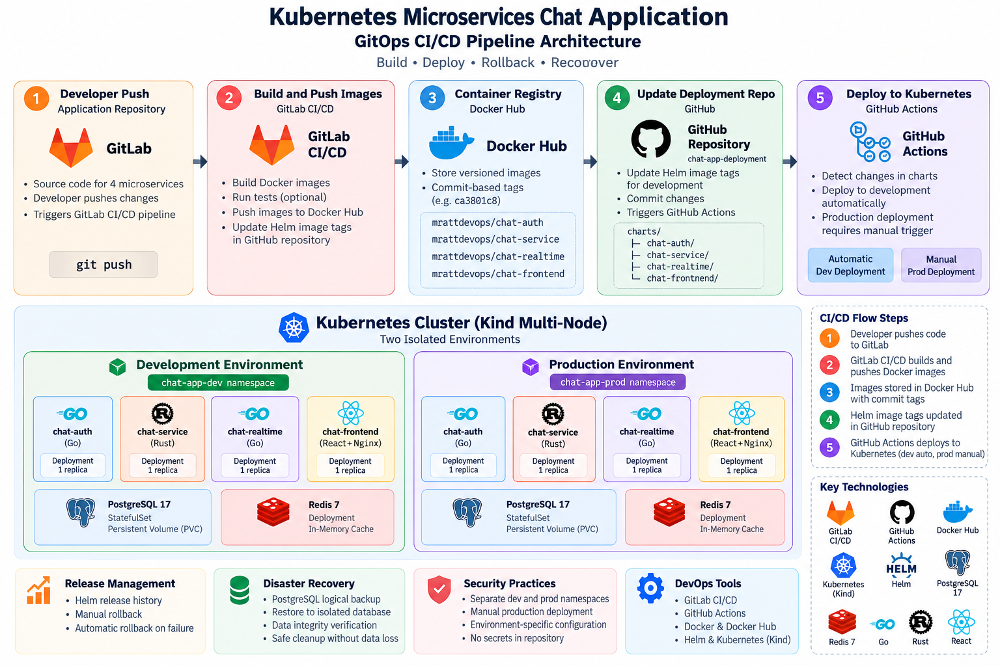

## CI/CD Architecture



# Kubernetes Microservices Chat Application — GitOps CI/CD

An end-to-end DevOps portfolio project demonstrating automated container builds, GitOps-style Kubernetes deployments, environment separation, release management, and disaster recovery.

## Project Overview

This project implements a push-based GitOps-style CI/CD workflow for a microservices chat application deployed on a multi-node Kubernetes cluster.

Application source code is managed in GitLab, while Kubernetes Helm charts and deployment configurations are maintained in a separate GitHub repository.

GitLab CI/CD builds and publishes container images to Docker Hub, then updates the development image tags in the GitHub deployment repository. GitHub Actions deploys the updated Helm charts to Kubernetes.

Development deployments are automated, while production deployments require manual workflow execution.

## Technology Stack

| Category | Technologies |
|---|---|
| Source Control | GitLab, GitHub |
| Continuous Integration | GitLab CI/CD |
| Continuous Deployment | GitHub Actions |
| Containerization | Docker, Docker Hub |
| Orchestration | Kubernetes, Kind |
| Package Management | Helm |
| Backend | Go, Rust |
| Frontend | React, Nginx |
| Database | PostgreSQL 17 |
| Cache | Redis 7 |
| Automation | Bash, YAML |

## Application Architecture

The application consists of four microservices:

| Service | Technology | Responsibility |
|---|---|---|
| chat-auth | Go | Authentication |
| chat-service | Rust | Chat functionality |
| chat-realtime | Go | WebSocket communication |
| chat-frontend | React, Nginx | Web interface |

PostgreSQL provides persistent relational data storage, while Redis supports application caching and related runtime functionality.

## CI/CD Workflow

1. A developer pushes application changes to the GitLab repository.
2. GitLab CI/CD runs the configured pipeline and builds Docker images.
3. Successfully built images are pushed to Docker Hub with commit-based tags.
4. The pipeline updates the corresponding Helm image tags in the GitHub deployment repository.
5. GitHub Actions detects changes and deploys eligible Helm charts to the development environment.
6. Production deployments are triggered manually using GitHub Actions.

This approach separates application development from Kubernetes deployment configuration.

**GitOps model:** Push-based GitOps-style deployment. GitHub stores the desired Helm configuration, and GitHub Actions applies changes to the cluster. Continuous in-cluster reconciliation is not implemented.

## Kubernetes Environments

The project uses separate Kubernetes namespaces:

- `chat-app-dev` — automated development deployments
- `chat-app-prod` — manually controlled production deployments

Each application service has its own Helm chart with shared defaults and environment-specific values.

Example chart structure:

```text
charts/
├── chat-auth/
├── chat-service/
├── chat-realtime/
└── chat-frontend/
```

Each chart includes:

```text
Chart.yaml
values.yaml
values-dev.yaml
values-prod.yaml
templates/
```

Infrastructure Helm charts are maintained separately for PostgreSQL and Redis.

## Release Management and Recovery

### Manual Helm Rollback

Tested a Helm upgrade that changed the authentication service from one replica to two, then successfully rolled back to the previous configuration.

### Automatic Rollback

Simulated a failed deployment using an invalid Docker image tag.

Helm automatically recovered the release after the failed upgrade:

- Revision 8 — previous working release
- Revision 9 — failed upgrade
- Revision 10 — successfully deployed rollback

### PostgreSQL Backup and Restore

Performed a logical PostgreSQL backup using `pg_dump` and restored the archive into an isolated test database.

Verified the recovery using:

- PostgreSQL custom-format archive inspection
- Original and restored row-count comparison
- Table-data checksum comparison
- Safe removal of the temporary restore database

The original database and persistent volume remained intact.

These exercises validate application rollback and logical database recovery, rather than a complete production disaster recovery system.

## Security and Deployment Practices

- Separate development and production Kubernetes namespaces
- Manually triggered production deployment workflow
- Environment-specific Helm configuration
- Commit-based Docker image tagging
- Helm release history and rollback support
- Backup testing without overwriting the original database

Credentials and sensitive configuration should be stored securely and must not be committed to public repositories.

## Repositories

**Application Source Code:**  
https://gitlab.com/mrattdevops/chat-app

**Kubernetes Deployment and CI/CD:**  
https://github.com/mrattdevops/chat-app-deployment

## Technical Documentation

- [CI/CD Workflow](docs/cicd-workflow.md)
- [Kubernetes Deployment Guide](docs/deployment-guide.md)
- [Helm Rollback and PostgreSQL Recovery](docs/rollback-and-recovery.md)

## Project Outcomes

This project demonstrates practical experience with:

- Building CI/CD workflows across GitLab and GitHub
- Managing multiple Dockerized microservices
- Deploying applications with Helm and Kubernetes
- Separating development and production environments
- Implementing GitOps-style deployment automation
- Troubleshooting failed deployments
- Performing Helm rollback and database recovery testing

## Future Improvements

- Production-grade monitoring and alerting
- Automated database backups and retention
- External backup storage and separate-instance restore testing
- Automated database schema migrations
- Policy-based deployment approval and security scanning

## Author

**DevOps Engineering Portfolio Project**

Focused on cloud infrastructure, Kubernetes, CI/CD automation, GitOps practices, and production reliability.